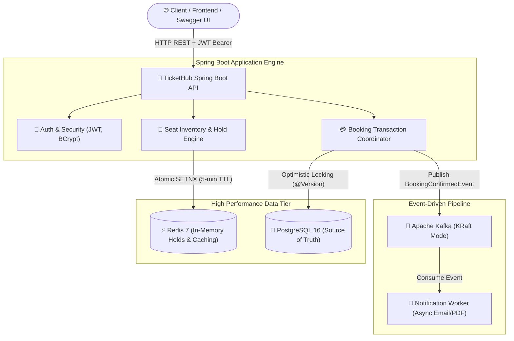
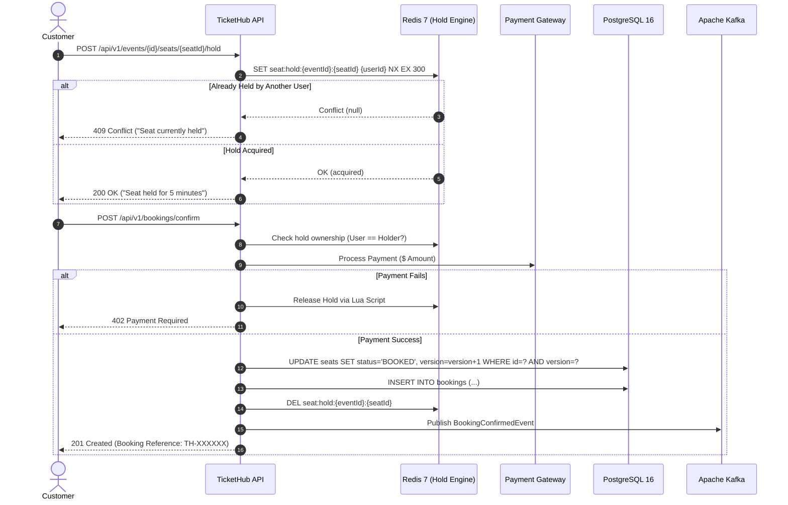

# 🎟️ TicketHub: Concurrency-Safe Event Ticket Booking Backend

[](https://github.com/ronaksalekar/tickethub-backend/actions)


TicketHub is a high-throughput, concurrency-safe ticket reservation backend built with **Spring Boot 3** and **Java 21**. It solves the classic flash-sale inventory problem where thousands of concurrent users race to reserve the same limited seats.

---

## 🌟 Architectural Highlights

1. **Two-Tier Concurrency Defense:**
   * **Tier 1 (Frontline In-Memory Engine):** Uses Redis atomic `SET seat:hold:{eventId}:{seatId} {userId} NX EX 300` to absorb traffic spikes in sub-milliseconds without disk I/O.
   * **Tier 2 (Relational ACID Backstop):** Uses PostgreSQL with Hibernate Optimistic Locking (`@Version`) as the single source of truth to guarantee zero double bookings.
2. **Atomic Lua Script Release:**
   * Replaces vulnerable check-then-delete patterns with an atomic Redis Lua script, eliminating race conditions during expired hold releases.
3. **Non-Blocking Checkout Transaction:**
   * Payment simulation executes **outside** the database transaction, preventing HikariCP connection pool exhaustion during external HTTP latency spikes. Includes automated compensatory refunds if subsequent DB commits fail.
4. **Decoupled Asynchronous Messaging:**
   * Booking confirmations publish events to **Apache Kafka**, offloading receipt and notification generation from the critical checkout path.
5. **Empirically Stress Tested:**
   * Validated using a multi-threaded stress test (`CountDownLatch` + `ExecutorService`) proving **0.00% double-booking rate under 50 simultaneous parallel threads**.

---

## 🏗️ System Architecture



---

## 🔄 Two-Phase Reservation Sequence



---

## 📊 Concurrency Stress Test Results

The suite includes an automated multi-threaded integration stress test ([`BookingConcurrencyStressTest.java`](src/test/java/com/tickethub/concurrency/BookingConcurrencyStressTest.java)) where **50 threads** line up at a `CountDownLatch` starting gun and hammer the same seat simultaneously:

```text
=========================================================
CONCURRENCY STRESS TEST RESULT:
Concurrent parallel requests : 50
Successful bookings/holds    : 1
Blocked double-bookings      : 49
Double booking rate          : 0.00% (ZERO DOUBLE BOOKINGS)
Database Integrity           : 1 record committed, version = 1
=========================================================
```

---

## 🚀 REST API Reference

Interactive Swagger UI documentation is available at: **`http://localhost:8080/swagger-ui.html`**

| Module | Method | Endpoint | Access | Description |
|---|---|---|---|---|
| **Auth** | `POST` | `/api/v1/auth/register` | Public | Register a new customer account |
| **Auth** | `POST` | `/api/v1/auth/login` | Public | Login and receive Bearer JWT |
| **Users** | `GET` | `/api/v1/users/me` | Authenticated | Retrieve authenticated user profile |
| **Events** | `GET` | `/api/v1/events` | Public | List upcoming events (Paginated & Sorted) |
| **Events** | `GET` | `/api/v1/events/{id}` | Public | Get event details (Cached in Redis) |
| **Admin** | `POST` | `/api/v1/admin/venues` | `ROLE_ADMIN` | Create venue |
| **Admin** | `POST` | `/api/v1/admin/events` | `ROLE_ADMIN` | Create event & auto-populate seat inventory |
| **Seats** | `GET` | `/api/v1/events/{id}/seats` | Public | Real-time seat map (AVAILABLE, HELD + TTL, BOOKED) |
| **Seats** | `POST` | `/api/v1/events/{id}/seats/{seatId}/hold` | Authenticated | Place 5-minute atomic Redis hold |
| **Seats** | `DELETE`| `/api/v1/events/{id}/seats/{seatId}/hold` | Authenticated | Release hold via atomic Lua script |
| **Bookings** | `POST` | `/api/v1/bookings/confirm` | Authenticated | Confirm hold into booking + payment |
| **Bookings** | `GET` | `/api/v1/bookings/my` | Authenticated | View current user's booking history |
| **Bookings** | `POST` | `/api/v1/bookings/{id}/cancel` | Authenticated | Cancel booking & restore seat |

---

## 🛠️ Local Setup & Quickstart

### Prerequisites
* **Docker & Docker Compose** installed
* **Java 21** & **Maven** (or use bundled `./mvnw`)

### Option A: Run Full Stack with One Command (Docker Compose)
Spins up PostgreSQL, Redis, Apache Kafka (KRaft), and the Spring Boot API:

```bash
docker compose up --build
```
* **API:** `http://localhost:8080`
* **Swagger UI:** `http://localhost:8080/swagger-ui.html`
* **Health Check:** `http://localhost:8080/actuator/health`

### Option B: Local Development
1. Start backing services:
   ```bash
   docker compose up -d postgres redis kafka
   ```
2. Run database migrations and start backend:
   ```bash
   ./mvnw spring-boot:run
   ```
3. Run test suite:
   ```bash
   ./mvnw test
   ```

---

## 🔐 Default Admin Credentials

Upon startup, `DataInitializer` seeds a default administrator account:
* **Email:** `admin@tickethub.com`
* **Password:** `Admin@123456`
* **Role:** `ROLE_ADMIN`
